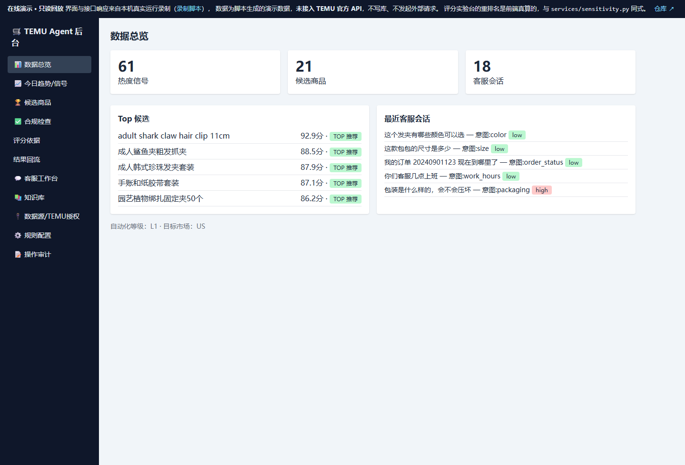
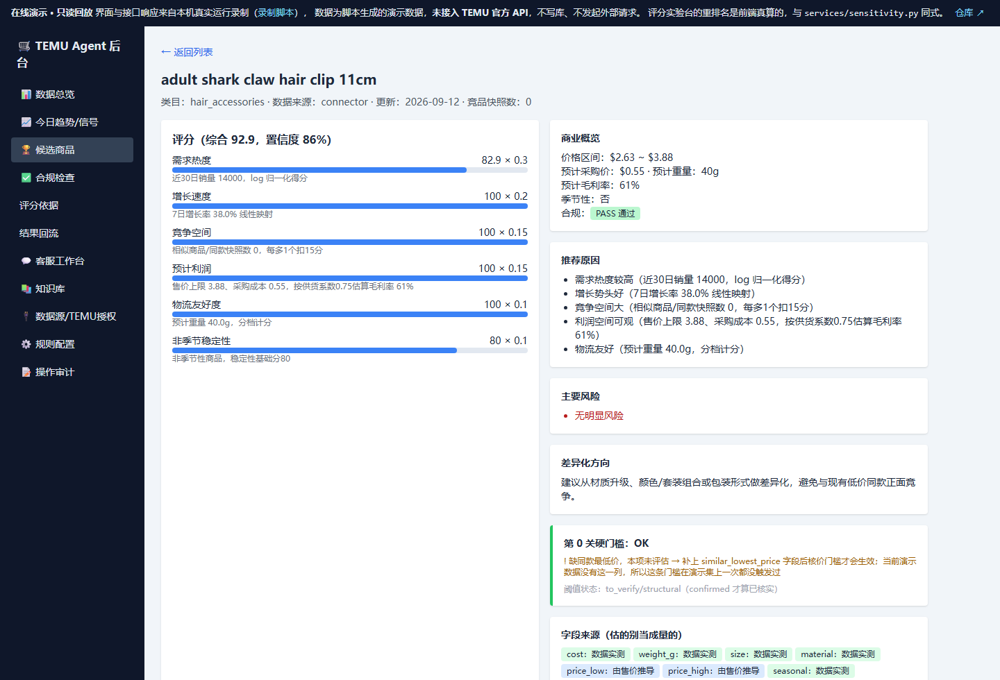
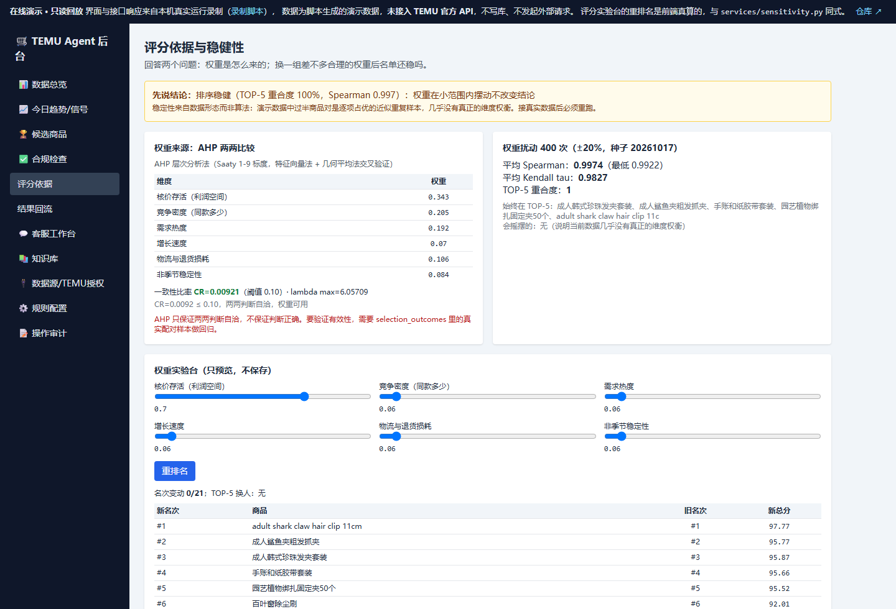

# TEMU 全托管卖家 Agent（第一阶段 MVP）

面向 TEMU 全托管卖家的中文运营后台：**趋势选品（AI 建议 + 人工审批）+ 客服回复草稿 + 合规硬门槛 + 评分可信度层 + 操作审计**。
无 TEMU 店铺授权也能用演示数据 / CSV 导入完整跑通。

三个 Agent 的分工是写死的：数值与风险判断全部由程序规则完成，**大模型不参与任何打分**，也不允许它编造订单或物流信息。

**▶ [在线演示·只读回放](https://yanx5433-cmd.github.io/temu-agent/)**（GitHub Pages，免登录，手机可看）


---

## 先看这个：哪些是真的，哪些是我拍的

这个项目最容易讲歪的地方就是"数据"。逐表核实过，口径如下：

| 内容 | 真实程度 | 依据 |
| --- | --- | --- |
| 61 条商品信号 | **60 条 `source=demo`**（手写 `backend/data/sample_products.csv`），1 条 `source=connector` 也是构造的 | 查 `product_signals.source` |
| 21 个候选、评分、合规结果 | **程序对这批演示数据真算出来的**，不是手填的 | 跑 `POST /api/selection/run` 可复现 |
| 5 篇知识库、5 条客服会话 | 手写样例（`source=manual`） | `seed.py` |
| 审计日志 | 真执行痕迹，第一条就是 `action=seed_demo` | `audit_events` |
| 评分权重（需求 30% / 增长 20% / 竞争 15% / 利润 15% / 物流 10% / 稳定 10%） | **经验值，不是 TEMU 官方标准**（平台不公开选品权重与核价公式） | `app_settings` 表 |
| 第 0 关 6 个门槛阈值 | **0 个已核实**，全部标 `to_verify` | `services/gate.py` |
| 命中率 / 推荐有效性 | **无法计算**：需要 ≥30 条"推荐→实际动销"配对样本，当前 0 条 | `services/outcomes.py` |

完整推导与依据强度见 **[docs/评分标准.md](docs/评分标准.md)**。
一句话立场：**算法是真的、可复算的；数据是演示的；权重是待校准的起点值。**

## 运行

```bash
cd backend
pip install -r requirements.txt
uvicorn app.main:app --reload --port 8000      # 打开 http://127.0.0.1:8000
```

首次启动自动导入演示数据（含应当被拦截的违禁品示例）。想用 PostgreSQL + Redis：`cp .env.example .env && docker compose up --build`。

```bash
cd backend && pytest -q                     # 78 项测试
python -m app.services.ahp                  # 权重推导 + 一致性检验
python scripts/run_sensitivity.py           # 权重扰动分析 → reports/sensitivity.json
```

CSV 导入格式见 `backend/data/sample_products.csv`，表头：
`external_id,title,category,price,sales_30d,growth_7d,review_count,weight_g,cost,size,material`

## 在线演示是怎么做到的（不撒谎版）

FastAPI + SQLite 没法直接放 Pages，所以演示是**同一份后台页面 + 一层接口回放**：

| 文件 | 作用 |
| --- | --- |
| `backend/scripts/capture_demo_snapshot.py` | 把 `data/temu_agent.db` 复制一份到临时目录，用 `TestClient` 真跑一遍所有读写，录下 32 个 GET 响应、21 个候选的合规复查、18 条会话的客服草稿、4 种接入方式的能力声明 → `demo/snapshot.json` |
| `backend/scripts/build_demo.py` | 由 `backend/templates/admin.html` 生成 `demo/index.html`，只换样式引用、加横幅、挂回放层，**不改一行业务逻辑** |
| `demo/shim.js` | 拦截 `/api/**`：只读请求回放录制响应；批准、发送、改权重、加知识库是前端真改内存状态；**权重实验台的重排名是前端按 `services/sensitivity.py` 同式现算的** |

所以演示里点"运行选品分析""重新检查""生成回复草稿"看到的是本机真实执行过的结果；
上传 CSV、official 授权这类要动外部系统的操作在演示里明确关闭并说明原因；
没录制过的问题会直接回"这条问题没有录制过"，而不是编一个像样的答案。

演示页样式为预编译 Tailwind（`demo/tailwind.css` 11 KB），零运行时依赖、零第三方请求。

## 界面

| 数据总览 | 候选详情：分项评分 + 第 0 关门槛 + 字段来源 | 评分依据：AHP 权重 + 扰动稳健性 + 实验台 |
| --- | --- | --- |
|  |  |  |

## 演示步骤

1. **数据总览**：信号 / 候选 / 会话统计。
2. **今日趋势**：点「▶ 运行选品分析」，系统对全部信号做聚类、合规硬过滤、评分。
3. **候选商品**：排行榜 `TOP/CONSIDER` 可「批准」，`REJECT`（儿童玩具、带电池、液体、侵权等）批准不了；点标题进详情能看到每个分项的计算依据。
4. **合规检查**：对任意商品重新执行规则检查，查看命中规则。
5. **客服工作台**：输入买家问题（如「这个发夹有哪些颜色可以选」「我要退款」），生成带置信度与引用来源的草稿；高风险强制转人工，回复需人工确认后才算发送。
6. **评分依据**：AHP 权重推导（CR=0.0092 通过）、±20% 扰动 400 次的排名稳健性、权重实验台重排名。
7. **结果回流**：导入"推荐→实际动销"配对样本算命中率；样本 <30 条时**拒绝给结论**，只给描述性统计。
8. **规则配置 / 操作审计**：权重和必须为 1（否则保存被拒）；导入、选品、审批、发送、配置变更全部留痕。

## 系统架构

```
数据来源层   TEMU公开页面/公开趋势/搜索趋势/节日日历/CSV/供应商报价/官方API（后续）
数据接入层   定时调度(Celery预留) / CSV导入器 / TEMU适配器 / 清洗标准化 / 聚类去重 / 重试限流
数据存储层   PostgreSQL(pgvector预留) / Redis / SQLite(本地模式) / 对象存储(预留)
智能工作流   选品Agent / 合规Agent / 客服Agent —— 确定性编排；数值与风险判断全部由程序规则完成
应用层       中文运营后台（总览/趋势/候选/合规/评分依据/结果回流/客服/知识库/数据源/配置/审计）
```

三个专职 Agent 的职责边界：

- **选品 Agent**：热度变化、季节性、竞争度、利润与物流估算、评分排行、可解释理由。每个分项都带 `detail` 说明怎么算出来的，字段标注 `measured / derived / default / missing` 四种来源，估的不跟量的长得一样。**大模型不参与任何打分。**
- **合规 Agent**：选品前置门槛。**13 类**硬性禁售规则（儿童用品、玩具、食品保健品、化妆品、医疗功效、带电池/插电/无线、液体粉末喷雾、刀具、安全防护、承重件、食品接触、高风险宠物用品、疑似侵权）命中即 REJECT；**4 项**资料缺失检查（重量/尺寸/材料/供应信息）命中为 REVIEW。只允许 PASS / REVIEW / REJECT 三种结果，全部保存命中规则与解释。PASS 仅表示"未发现特定品类的复杂准入要求"，最终仍需人工确认平台与目标市场法规。
- **客服 Agent**：识别语言→意图→查知识与订单→生成回复→风险检查→分级处理。退款赔偿、客诉升级、人身安全、法律、地址改、无答案、低置信度、要求人工一律转人工。回复标注引用来源，不编造订单/物流信息。自动化等级 L0/L1（默认）/L2/L3，L3 高风险永不自动。

## 评分可信度层

评分本身不难，难的是说清**哪些数字有依据**。

| 模块 | 干什么 | 关键设计 |
| --- | --- | --- |
| `services/gate.py` | 第 0 关硬门槛：超重、负毛利、价格无空间、缺强制认证 | 门槛在评分**之前**，高分买不通资格；每个阈值带 `confirmed/to_verify/structural` 状态 |
| `services/ahp.py` | 用 AHP 两两比较推导权重 | 输出一致性比率 CR，矛盾判断会被拒绝；特征向量法与几何平均法互验 |
| `services/sensitivity.py` | 权重 ±20% 扰动 × N 次，量化排名稳定性 | 输出 Spearman / Kendall / TOP-K 重合度，以及"哪些商品会摇摆" |
| `services/outcomes.py` | 导入"推荐→实际动销"配对样本，算命中率 | **样本 <30 条时拒绝给结论**，只给描述性统计 |
| `services/scoring.py` | 每个字段标注来源 | `measured / derived / default / missing` |

## 当前的诚实状态

| 项 | 状态 |
| --- | --- |
| 门槛阈值已核实 | **0 / 6** 个 confirmed，全部待核实 |
| 核价门槛在演示集上的触发次数 | **0** 次（演示数据缺 `similar_lowest_price` 字段，这条门槛根本没参与判定） |
| 命中率验证 | **无法计算**，配对样本 0 条 |
| AHP 一致性 | CR = 0.0092，通过 |
| 排名稳健性 | TOP-5 扰动 1000 次不变——**但这是演示数据近似重复造成的，不可外推** |
| 线上权重 | 仍是旧的拍板值。AHP 权重只推导展示，**未自动替换配置** |
| 知识库检索 | 关键词命中，**会跨商品答错**：演示里问「这款包包的尺寸」会命中发夹条目；无答案时置信度 0 并转人工 |
| 多语言回复 | 能识别中/英/西并选模板，但知识库正文是中文，英文问题会得到中英混排的回答 |

## 关键 API

`POST /api/imports/products`、`POST /api/imports/csv`、`GET /api/signals`、`POST /api/selection/run`、
`GET /api/candidates`、`GET /api/candidates/{id}`、`POST /api/candidates/{id}/compliance-check`、`POST /api/candidates/{id}/approve`、
`GET|POST /api/conversations`、`POST /api/conversations/{id}/generate-reply`、`POST /api/replies/{id}/approve`、`POST /api/replies/{id}/send`、
`GET|POST /api/knowledge`、`GET /api/audit-events`、`GET|POST /api/settings`、`GET /api/settings/integrations`、`POST /api/settings/integrations/temu`、
`GET /api/scoring/weights-derivation`、`GET /api/scoring/sensitivity`、`POST /api/scoring/whatif`、`GET /api/outcomes/report`、`POST /api/outcomes/import`

本地运行时交互式文档在 http://127.0.0.1:8000/docs 。

## 目录结构

```
temu-agent/
├── docker-compose.yml                # PostgreSQL + Redis + 后端
├── .env.example                      # 示例环境变量（密钥只放 .env）
├── demo/                             # 在线演示（gh-pages 分支同源，零依赖静态站）
│   ├── index.html                    # 由 scripts/build_demo.py 从 admin.html 生成
│   ├── shim.js                       # 接口回放层
│   ├── snapshot.json                 # 本机真实运行录制的响应
│   └── tailwind.css                  # 预编译样式
├── docs/
│   ├── 评分标准.md                    # 权重与阈值的依据强度、校准路径
│   └── images/                       # README 截图
└── backend/
    ├── app/
    │   ├── main.py                   # FastAPI 入口 + 后台页
    │   ├── config.py                 # 全部配置来自环境变量
    │   ├── db.py / models.py         # SQLAlchemy 模型
    │   ├── schemas.py                # Pydantic 校验
    │   ├── appsettings.py            # 权重/市场/自动化等级设置 + 审计
    │   ├── seed.py                   # 演示数据（含违禁品示例）
    │   ├── adapters/temu.py          # TemuAdapter / MockTemuAdapter / OfficialTemuAdapter
    │   ├── services/
    │   │   ├── importer.py           # 信号导入、CSV、清洗、聚类去重
    │   │   ├── compliance.py         # 13 类禁售 + 4 项资料缺失
    │   │   ├── gate.py               # 第 0 关硬门槛
    │   │   ├── scoring.py            # 评分（可追溯 score_detail + 字段来源）
    │   │   ├── selection.py          # 选品编排
    │   │   ├── ahp.py                # 权重推导与一致性检验
    │   │   ├── sensitivity.py        # 扰动分析与排名稳健性
    │   │   ├── outcomes.py           # 结果回流与命中率
    │   │   ├── customer_service.py   # 客服工作流
    │   │   └── llm.py                # LLMProvider（规则实现 + OpenAI 兼容，自动降级）
    │   └── routers/api.py            # 26 个接口
    ├── alembic/                      # 数据库迁移
    ├── templates/admin.html          # 中文管理后台（单文件，Tailwind）
    ├── scripts/                      # 快照录制 / 演示构建 / 敏感性分析
    ├── data/sample_products.csv      # 示例导入文件
    └── tests/                        # pytest 78 项
```

后端 `app/` 共 2,979 行 Python；含测试、脚本与演示页，全仓 5,361 行。

## 核心数据模型

`ProductSignal`（原始热度快照）、`ProductCandidate`（候选+评分+score_detail）、`ComplianceCheck`（合规记录）、
`CustomerConversation` / `ReplyDraft`（客服会话与回复草稿）、`KnowledgeDocument`（知识库）、
`AuditEvent`（操作审计）、`AppSetting`（可配置规则）、`IntegrationSetting`（接入配置，密钥加密存储）、`TrendSnapshot`（趋势历史）、
`SelectionOutcome`（推荐→动销配对样本）。

## 关键假设与默认值

1. **前端**：第一阶段用后端渲染的中文单页后台（Tailwind），Next.js 留到后续 —— 让 MVP 在无 Node 构建环境下也能跑，API 已按前后端分离设计。
2. **数据库**：本地默认 SQLite（零依赖），Docker Compose 下用 PostgreSQL；pgvector 语义检索第二阶段接入（当前知识库用关键词匹配）。
3. **利润估算**：售价×0.75 供货系数减采购成本（全托管粗略模型），可在 `services/scoring.py` 调整。
4. **演示订单**：客服演示用订单号 `20240901123`（运输中）、`20240901456`（已签收）。
5. **"同款去重"**：按归一化标题+类目聚类；跨语言同款识别留待第二阶段 embedding 方案。
6. **密钥存储**：MVP 中 TEMU 密钥经混淆后入库，任何接口/日志不回显；生产建议 KMS 或 fernet。仓库里 `integration_settings` 表为空，没有任何真实凭证。

## 暂未接入的 TEMU 官方功能（如实声明，不以模拟冒充真实）

以下能力当前**均未接入 TEMU 官方 Open API**（无授权凭证）：官方 OAuth 授权与 Token 刷新（仅有骨架）、
商品列表/详情同步、订单查询、库存查询、物流轨迹查询、站内信拉取与自动发送。

替代方式（界面中已明确显示）：商品信号用演示数据/CSV 导入；订单状态用演示数据；买家回复用**人工复制模式**（在卖家后台手工粘贴）。
`OfficialTemuAdapter` 已实现带超时/重试/限流的请求通道，取得 TEMU Partner Platform 授权后只需在后台切换为 official 并填写密钥。
系统不会调用私有接口或绕过任何验证。

## 阶段路线

- ✅ 第一阶段：无店铺 MVP（本仓库）
- ✅ 在线演示：只读回放，GitHub Pages
- ⬜ 第二阶段：公开趋势连接器、定时采集、历史趋势图（`TrendSnapshot` 已预留）、pgvector 聚类、知识库换 embedding 检索
- ⬜ 第三阶段：TEMU 官方授权接入，按实际开放权限启用同步
- ⬜ 第四阶段：用卖家后台导出数据校准权重（AHP → 回测 → 敏感性），统计人工采纳率，达标 FAQ 才进入 L2 自动发送

## 许可

MIT，见 [LICENSE](LICENSE)。
